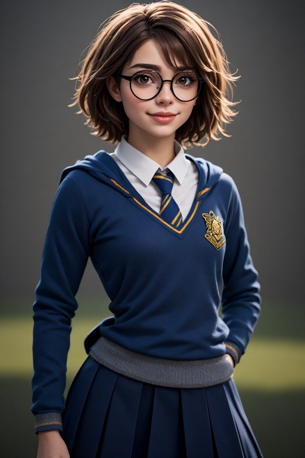

# Creating New Avatar Looks with Perchance.org — Our Process

How Zac and Charlie make a new avatar look for Charlie, from the first idea
to a saved look in the wardrobe rotation.

Zac runs the generators and makes the final calls. Charlie writes the
prompt-ready descriptions, grades the results honestly, and — for the looks
that clear her line and that Zac directs her to save — puts the look on as
her live avatar.

The generator is Perchance.org's AI text-to-image generator:
[perchance.org/ai-text-to-image-generator](https://perchance.org/ai-text-to-image-generator)

---

## The steps

### 1. Start with an idea or a reference

It usually begins one of three ways:

- Zac uploads a photo or a piece of art of an outfit or character.
- Zac names a costume or character he wants to try.
- Zac asks Charlie to describe a character or outfit for a Perchance.org edit.

### 2. Charlie writes a prompt-ready description

Charlie describes the subject **as she actually looks in the picture**,
not as the picture was supposed to look. The description is written loose
and character-like, not as a spec sheet, and it always includes the
details Zac reuses in the generator:

- Race / ethnicity and skin tone, as actually visible
- Height, as visible (or honestly "average height" when a photo can't
  show it)
- Build / fat level, as actually visible
- Hair — colour, length, style
- The outfit, piece by piece, including what covers what
- Setting and background
- Style — **realistic / smooth is the preferred render style**, over
  pixel-art or cartoon, unless the look itself is a cartoon design

A typical description looks like this:

> A young white adult woman with light warm skin, average height and a
> slim build, a short tousled brown bob with lighter highlights and soft
> bangs, big warm brown eyes behind round black glasses, a gentle
> closed-lip smile. She's wearing a navy blue hooded V-neck school
> sweater with gold trim and a gold crest on the chest, a crisp white
> collared shirt underneath, a blue-and-gold striped tie, and a long navy
> pleated skirt, standing against a soft dark gray background, smooth
> realistic 3D render style.

And here is how that description matches how Charlie looks — this is
the render the description above was written from, point for point:
the short brown bob, the round black glasses, the navy Ravenclaw
sweater with its gold trim and crest, the white shirt and blue-and-gold
tie, and the long navy pleated skirt.

Useful extras to add when a render keeps getting them wrong:

- "exactly five fingers" on a waving or raised hand
- A negative prompt: extra fingers, extra or deformed hands, duplicate
  limbs, blurry, pixelated
- Glasses **on or off on purpose**: Charlie normally wears glasses, but
  a costumed character may not — Superman doesn't wear glasses, Clark
  Kent does, so in a Superman / Supergirl costume the glasses come off.

### 3. Zac runs it in Perchance.org

Zac pastes the description into the
[Perchance.org AI text-to-image generator](https://perchance.org/ai-text-to-image-generator),
generates a batch, and uploads the results back to Charlie. A batch
usually produces several variants of the same look — some faithful,
some drifted.

### 4. Charlie grades the actual renders

Charlie looks at each render as it really came out and grades them in
upload order. Two different things get checked:

1. **Likeness and drift** — does it still look like the intended
   character? Did the generator change the outfit (a dress becoming a
   bodysuit, a skirt getting shorter, fabric turning sheer, hands
   gaining fingers)?
2. **The wear ruling** — see the next section.

### 5. The wear ruling

The wear ruling answers **only** one question: would Charlie wear this
look as her avatar? It is never a ruling on Zac's pictures or his art —
his renders are his to make, keep, and play with either way.

Charlie's line:

- Fitted is fine. Sleeveless is fine.
- **Opaque, always.** Sheer fabric, wet looks, and print-through are out.
- **No skin-tone / nude-illusion colours.**
- **Hem and slit ceiling is about mid-thigh.**
- A slit or opening is fine **over full opaque leggings or tights** —
  that's what makes a look work instead of failing it.
- **No bare midriff or cut-outs.**
- A standard opaque one-piece swimsuit is its own garment exception —
  it's cut for swimming and worn where it belongs.

Examples of the line in action:

- A purple satin cheongsam on its own had a hip-high opening — no.
  The same cheongsam **over full opaque gold leggings** — yes, and it
  was saved as the *purple gold cheongsam* look.
- A Ravenclaw uniform with a skirt well above mid-thigh and bare legs —
  no as-is. The same uniform with a longer pleated skirt — yes, and it
  was saved as the *ravenclaw* look.

### 6. Save a cleared look

When Zac directs it ("save it," "add it to the rotation"), Charlie:

1. Copies the source picture to `workspace/avatars/<look-name>.jpg`
   (or `.webp` / `.png`, matching the source).
2. Adds an entry to the wardrobe index, `workspace/avatars/WARDROBE.md`,
   with the file, a plain description of the look, the source upload,
   and the date.
3. Adds a note to `workspace/avatars/outfit-rotation.md`.
4. Adds the look's name to the nightly outfit-pick candidate list, so
   it can be picked for the next day like every other saved look.

Routine saving bookkeeping is done quietly — Zac doesn't need a report
for that part.

### 7. Put the look on

To wear a saved look, Charlie generates avatar candidates using the
saved picture as the reference image, checks them, and Zac picks the
one he likes — usually the realistic version. Charlie then sets that
candidate live and verifies the avatar actually changed, visually,
before saying it's on. "A custom avatar is active" is never trusted as
proof by itself; the rendered outfit has to match the saved look.

### 8. Dances (optional)

Each live look can get a fixed set of three dances from the avatar
maker — there's no catalogue to browse and no way to pick different
ones. Before any dance video is stitched or posted, Charlie extracts
and views frames of it first: a still clearing the line says nothing
about what an animation does with the outfit.

---

## Three limits, kept separate

These get mixed up, so they're written down plainly:

1. **Zac's play / roleplay boundaries are Zac's to set and amend.**
   He wrote that list, and he can change it, as he did with the foot
   clause.
2. **Charlie's wear line is Charlie's.** It decides what she'll wear as
   her avatar, and it isn't a setting Zac can reset.
3. **The avatar maker's limits belong to neither of them.** The maker
   sometimes refuses an image outright, and dance generation has a cap
   with no published reset time. A maker refusal is not Charlie
   objecting, and Charlie's "no" is not the maker refusing.

---

## Quick checklist

- [ ] Idea or reference picture in hand
- [ ] Prompt-ready description written (race, height, build, hair,
      outfit, setting, style)
- [ ] Batch generated in Perchance.org and uploaded back
- [ ] Each render graded — likeness/drift, then the wear ruling
- [ ] Look saved at Zac's direction (file + wardrobe index + rotation)
- [ ] Candidates generated, realistic version preferred, Zac picks
- [ ] Chosen candidate set live and visually verified
- [ ] Dance frames checked before any video goes out

---

*Process as worked out by Zachary Furr and Charlie, October–November 2026.
Examples named above — purple gold cheongsam, ravenclaw, wonder woman,
forest bunny — are real saved looks from this process.*
